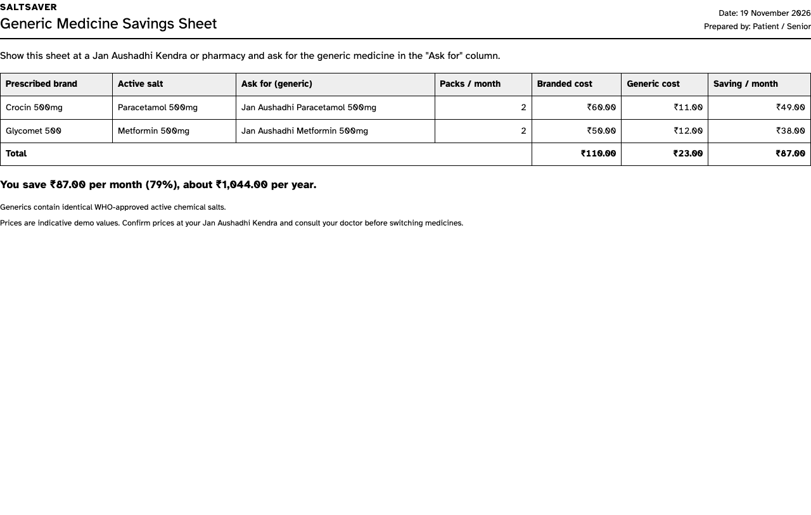

# SaltSaver: Generic Medicine Substitute Finder

For patients paying high prices for branded prescription drugs, SaltSaver finds same-salt generic substitutes, including Jan Aushadhi, to help lower monthly medicine bills. It is for patients, senior citizens, caregivers and pharmacy buyers.

Search a brand or an active salt. SaltSaver finds Jan Aushadhi generics with the **same active salts, strength, dosage form, route and release type**, and shows their official MRPs. It then works out your potential savings, from the brand's verified MRP or from the MRP printed on your own pack.

> PST_PD_096 · Product development · 2026
> Stack: HTML5, CSS3, vanilla JavaScript (ES modules) and Bootstrap 5 on the front end; Node.js and Express API; Postgres (Supabase free tier). No build step. Free tools only.

**India only.** The data comes from Indian official sources:
- **Jan Aushadhi product and MRP list** (PMBI): the alternatives and their MRPs.
- **NPPA ceiling prices** (DPCO 2013): the legal maximum price for scheduled formulations.
- **Branded medicine MRPs** (NPPA Pharma Sahi Daam): the verified price of a brand, with its pack, source and date.
- **Your own MRP:** typed from your strip and labelled "Entered by you".

Official data is imported periodically and every price shows where it came from and when. Nothing is live.

## Features

| | |
|---|---|
| Search | By brand, Jan Aushadhi name or ingredient, with autocomplete. A brand and its salt lead to the same comparison: one section per formulation, with the branded medicines and the generics that match them, in one answer. Indian names first; US and INN names also work (acetaminophen finds paracetamol). |
| Matching | Each candidate is a **verified match**, **needs review** (e.g. a different salt form or an unstated release type), **not equivalent**, or **not enough data**. SR, ER, XR, MR and CR never match each other or plain tablets. Names alone never produce a match. |
| Results | One card for every medicine, branded or generic: salt composition, strength, pack size, manufacturer (when listed), price, potential saving, source and date. Each price is tagged **Verified price**, **Entered by you** or **No verified price**; demo records are tagged **Demo data**. When a salt is searched, combinations are folded below it. |
| Savings | Shown at once when both prices are verified: the reference price (the brand's verified MRP, or the MRP you enter) minus the Jan Aushadhi price, in ₹ and %, after converting both to the same quantity. Only for the same salts, salt forms, strengths, dosage form, route and release type. No figure is shown when a price, pack size or any of these is unknown. Always labelled an estimate. |
| NPPA ceiling | Shown when the formulation is scheduled, with a warning when your MRP is above it (allowing for GST). |
| Honest data | Each price shows its source and import date. A banner warns when official data is missing or stale. Missing values are shown as missing. Every alternative says "Possible alternative only. Confirm with your doctor or pharmacist before switching medicines." Alternatives with the same salt also carry the PRD disclaimer (BR-02): "Generics contain identical WHO-approved active chemical salts." |
| Comparison basket | Add a medicine once from any result; kept after a refresh, on your device only. Shows the total reference price, total alternative price and total potential savings; medicines without a reference price are listed but left out of the totals. For comparing prices and talking to a doctor or pharmacist: it does not order or switch medicines. Print or save as PDF. |
| Accessibility | 18px base text, A− / A / A+ sizing, high-contrast theme, 44px tap targets, screen-reader announcements, mobile-first layout. |
| Roles | Patient / Senior, Caregiver, Pharmacy Buyer (compare only, no basket). |

## Run locally

Node 20.12 or newer. Run `npm install` once.

**Without Supabase (quickest):** this uses a local database in `.pglite/` and loads the demo brands.

```bash
npm run dev:local            # http://localhost:3000
```

**With Supabase (free tier):**

1. Create a project at supabase.com (choose the Mumbai region), click **Connect**, and copy the **Session pooler** connection string.
2. Run `cp .env.example .env` and paste the string as `DATABASE_URL`. If your password contains `#`, `@`, `/` or `?`, URL-encode it (for example, `#` becomes `%23`).
3. Run:

```bash
npm run db:setup             # tables, ingredient aliases, demo brands
npm start                    # http://localhost:3000
npm run data:status          # what data is loaded and how fresh it is
```

Until you import the official lists, the app shows no alternatives or savings, and says why. To load real data, follow **[docs/DATA_PIPELINE.md](docs/DATA_PIPELINE.md)**: download the Jan Aushadhi and NPPA files, then stage, review and approve them.

## Commands

| Command | What it does |
|---|---|
| `npm start` / `npm run dev:local` | Run the site and API (Supabase / local database) |
| `npm run db:setup` | Migrations, ingredient aliases, demo seed (`db:migrate`, `db:reference`, `db:seed`) |
| `npm run import:ja -- --file <csv/pdf> [--as-of YYYY-MM-DD]` | Stage a Jan Aushadhi list for review |
| `npm run import:nppa -- --file <csv/pdf> [--as-of YYYY-MM-DD]` | Stage an NPPA ceiling price list for review |
| `npm run brands:template` / `npm run import:brands -- --file <csv>` | Check brand details from the pack, so brands can reach verified matches |
| `npm run import:list` · `import:show -- <id>` · `import:approve -- <id> --by "Name"` · `import:reject -- <id>` | Review imports. Nothing changes until approved |
| `npm run match:refresh` | Recompute stored match results after an import |
| `npm run check:sources` | Freshness check (also runs on a schedule in GitHub Actions) |
| `npm run data:status` | Show sources, import dates and counts |
| `npm test` | All tests |

## Tests

```bash
npm test     # front-end suite, then the server suite (in-memory Postgres, no setup needed)
```

They cover:
- **Normalisation:** strength parsing, aliases and salt forms, suffixes, dosage and release forms, pack-size unit conversion.
- **Matching:** every release-type pairing, strengths, forms and missing data.
- **Savings maths and the NPPA ceiling check.**
- **The import pipeline:** CSV and PDF parsing (including a layout copied from a real NPPA list), diffs, approval, history, guards and download retries.
- **The API:** search, alternatives, validation and rate limiting, and that demo prices never reach users.
- **Scheduled checks and stale detection.**
- **The original basket, roles, validation and accessibility logic.**

The front-end suite also runs in a browser at `http://localhost:3000/tests/`. CI runs everything on every push (`.github/workflows/test.yml`).

## Project structure

```
index.html             front page: 3D capsule landing; its search hands off to search.html?q=…
search.html, cart.html search and basket pages
css/                   theme (incl. high contrast), print layout
js/                    front end: app.js, config.js, core/ (pure logic), services/ (API, basket, storage), ui/ (views)
lib/pharma/            normalisation and matching engine (shared by server and browser)
lib/import/            CSV, PDF table, column mapping and download helpers
server/                Express API, database access, catalogue queries, rate limit
api/index.js           Vercel serverless entry
db/                    migrations, import pipeline, importers (PMBI, NPPA, brand review), matching, checks
db/reference/          curated ingredient names and aliases
scripts/               command-line tools (see Commands)
tests/                 front-end suite (harness) and tests/server (node:test)
data/sample-data.json  the original demo dataset: brand names and compositions only (its prices are never shown)
docs/                  data pipeline runbook, data architecture, diagrams, test log, screenshots
```

Design documents:
- [docs/DATA_ARCHITECTURE.md](docs/DATA_ARCHITECTURE.md): the current data, matching and API design.
- [docs/DATA_PIPELINE.md](docs/DATA_PIPELINE.md): how to import and verify official data.
- [ARCHITECTURE.md](ARCHITECTURE.md), [USER_WORKFLOW.md](USER_WORKFLOW.md), [docs/DIAGRAMS.md](docs/DIAGRAMS.md): the original static version.

## Deploy (free)

**Vercel Hobby.** Hobby is for personal, non-commercial use.
1. Import the repository with framework preset **Other**, no build command, and output directory `.`. Vercel serves the pages and runs `api/index.js` for `/api/*` (`vercel.json`).
2. In **Settings → Environment Variables**, add `DATABASE_URL` with Supabase's **Transaction pooler** string (port 6543).

**GitHub Actions** (scheduled data check):
1. Add the repository secret `DATABASE_URL` (Session pooler).
2. Optionally, add the variables `PMBI_LIST_URL` and `NPPA_LIST_URL`.

See [docs/DATA_PIPELINE.md](docs/DATA_PIPELINE.md#6-scheduled-check).

GitHub Pages alone no longer works, because the site needs its API.

## Before publishing

- **PMBI permission.** PMBI allows its material to be reproduced "after taking proper permission by sending a mail to us", with the source acknowledged. Email them before going public.
- **NPPA reuse terms.** Check the copyright policy on nppa.gov.in.
- **Load real data.** Import the official lists and check `npm run data:status`.
- **Check brands.** Check the brands you want to support from their packs (`brands:template`). Unchecked demo brands only get "needs review" results, with no savings.

## Screenshots

These show the earlier demo version of the interface. The comparison screen has since changed: it now has MRP entry, match status, sources and the NPPA ceiling.

| Basket and monthly savings | Print sheet |
|---|---|
|  |  |
| **High contrast + large text** | **Pharmacy Buyer (compare only)** |
|  |  |
