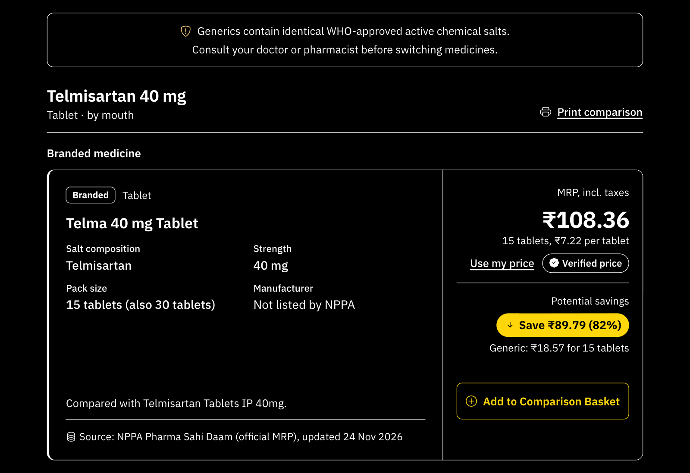
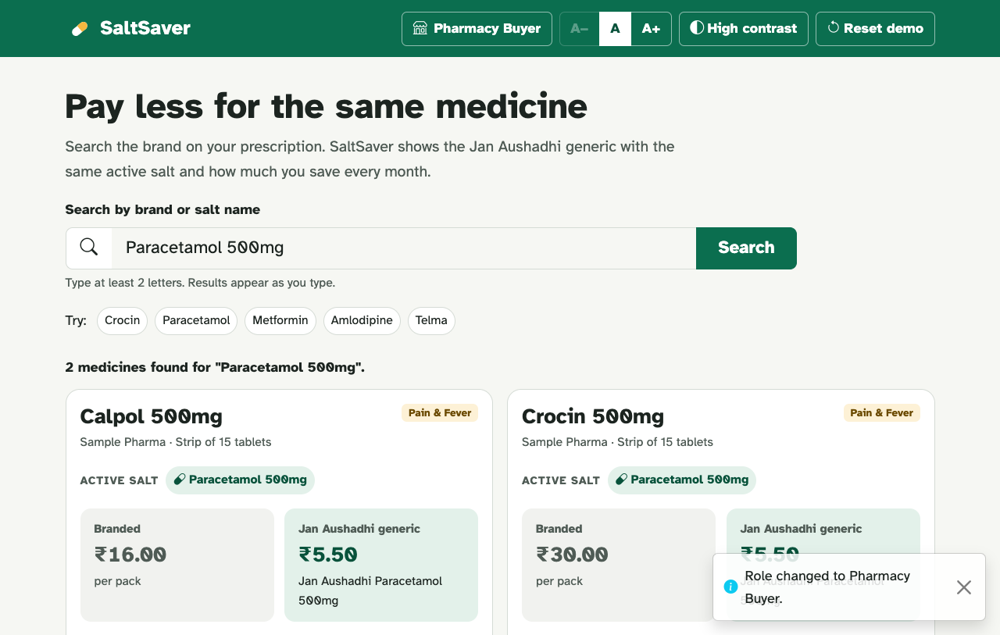

# SaltSaver — Generic Medicine Substitute Finder

Search the brand on your prescription. SaltSaver shows the **Jan Aushadhi generic with the same active salt**, the price difference, and how much you save every month.

> PST_PD_096 · Product development · 2026 Level 1 (Core)
> Stack: HTML5, CSS3, Vanilla JavaScript (ES modules), Bootstrap 5. No backend, no build step.


## Features

| PRD | Feature |
|---|---|
| FR-01 / BR-03 | Search by brand ("Crocin"), salt ("Paracetamol") or generic name. Results are ranked and appear as you type. |
| FR-02 / BR-02 | Comparison cards show branded vs Jan Aushadhi price, the **Save %** badge and the WHO disclaimer. |
| FR-03 / BR-01 | The Prescription Basket page (`cart.html`, opened from the cart icon in the navbar) adds up `(brandPrice − genericPrice) × packs` for every medicine, per month and per year. |
| FR-04 | The basket is saved in `localStorage` and restored after a reload. |
| FR-05 | Prints a clean savings sheet; use the browser's **Save as PDF** for a PDF. |
| PRD §4 | Roles: Patient / Senior, Caregiver, Pharmacy Buyer (compare only, no basket). |
| PRD §12 | Not-found message, "Quantity must be at least 1." check, and an in-memory fallback when storage is full. |
| PRD §16 | Large 18px base text, A− / A / A+ sizing, a high-contrast theme, 44px tap targets, screen-reader announcements. |

Extras: tap a salt badge to list every brand with that salt; the basket has −/+ steppers and Undo after removing an item; Reset demo.

## Run locally

ES modules and `fetch()` don't work over `file://`, so the app must be served over HTTP.

```bash
npm start                    # serves on http://localhost:3000
# or
python3 -m http.server 3000  # then open http://localhost:3000
```

In VS Code you can also right-click `index.html` and choose **Open with Live Server**.

## Tests

```bash
npm test                     # Node 18+, no dependencies
```

You can also open `http://localhost:3000/tests/` in a browser. The suite (27 tests) covers:

- normalization, salt keys, search ranking and salt grouping;
- paise-based savings math, including the PRD's ₹30.00 vs ₹5.50 → **Save 81%** case;
- quantity and data validation, and role rules;
- **every record in `data/sample-data.json`**: valid fields, generic cheaper than brand, generic salt equal to brand salt, findable by brand and by each salt, correct saving % (PRD §15);
- the services end to end: load, search, add, merge, savings, persist, remove and undo, and the Pharmacy Buyer block.

The manual acceptance tests are in [docs/TEST_LOG.md](docs/TEST_LOG.md).

## Project structure

```
index.html            search page (navbar with cart icon, search, results, modals, print sheet)
cart.html             Prescription Basket page (same navbar and store)
css/styles.css        theme, large type scale, high-contrast theme
css/print.css         print-only layout
js/app.js             start-up
js/config.js          storage keys, limits, all user-facing messages
js/core/              pure logic: normalize, saltIndex, search, savings, validate, roles, sanitize, errors
js/services/          storage (with memory fallback), dataService, medicineService, basketService
js/state/store.js     app state + subscribe
js/ui/                dom helper, searchView, medicineCard, basketView, cartBadge, roleSelector, a11yControls, printView, alerts
data/sample-data.json seed database (28 medicines)
tests/                harness, test suite, Node runner, browser runner
docs/                 diagrams, test log, screenshots
```

Design documents: [ARCHITECTURE.md](ARCHITECTURE.md) · [USER_WORKFLOW.md](USER_WORKFLOW.md) · [docs/DIAGRAMS.md](docs/DIAGRAMS.md)

## Decisions on the open PRD questions

These were listed for mentor review in ARCHITECTURE.md §13. The build uses the following defaults:

1. **Price unit:** prices are **per pack** and quantity is **packs per month**. Each card shows the pack size.
2. **Savings %:** rounded **down**, so the app never over-promises. This matches the PRD's 81%.
3. **Extra note:** the footer and print sheet add "Prices are indicative… consult your doctor before switching medicines."
4. **Role:** remembered between visits; change it from the navbar.

## Data note

The medicine list in `data/sample-data.json` is a **demo dataset**. Prices are illustrative, not official MRPs or Jan Aushadhi rates. Check them against the PMBJP product list before real use. To add a medicine, append a record with the same fields; the tests check the new record automatically.

## Deploy

**GitHub Pages:** push to GitHub → Settings → Pages → Deploy from branch `main`, folder `/ (root)`. All paths are relative, so the site works under `/<repo-name>/`.

**Vercel:** import the repo with framework preset **Other**. Leave the build command empty and set the output directory to `.`.

## Screenshots

| Basket and monthly savings | Print sheet |
|---|---|
|  |  |
| **High contrast + large text** | **Pharmacy Buyer (compare only)** |
|  |  |
