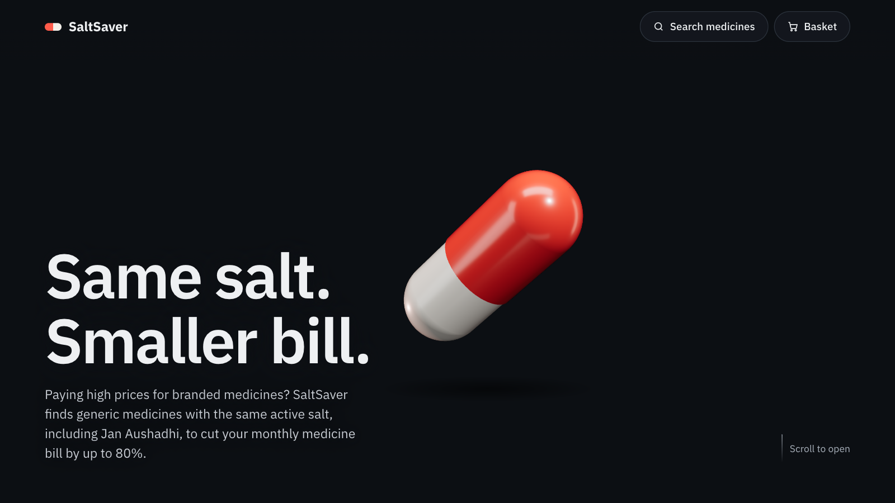
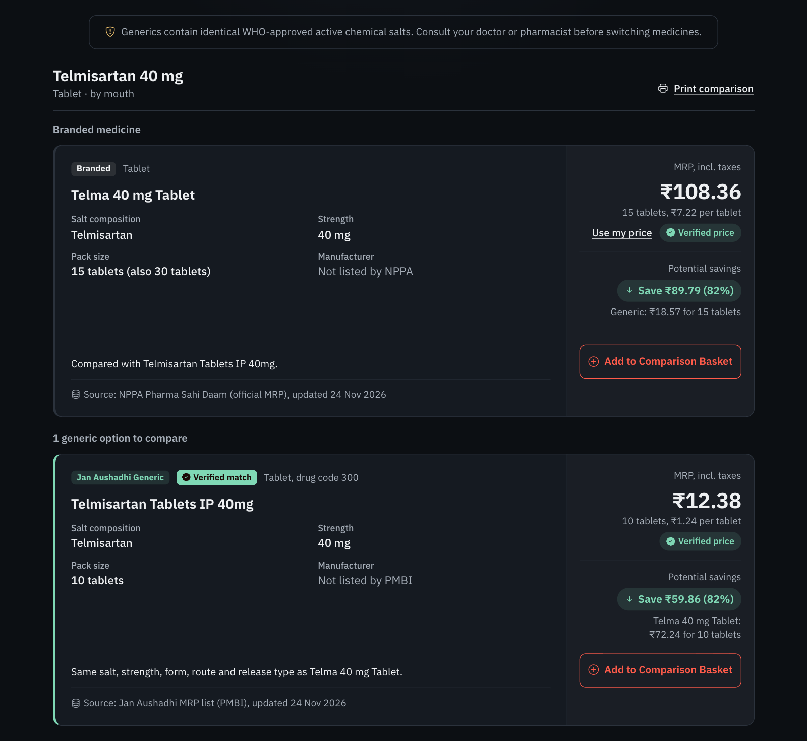
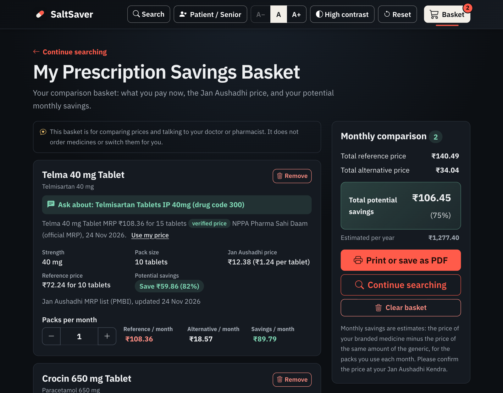
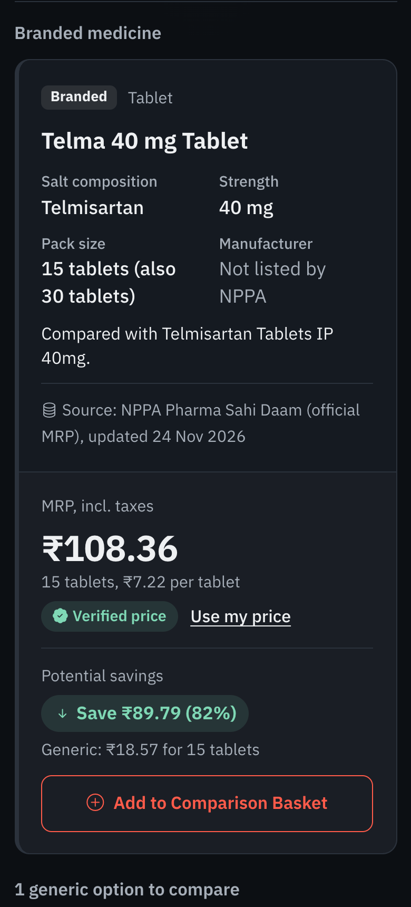

# SaltSaver

**Same salt. Smaller bill.**

SaltSaver helps people in India compare a branded medicine with the Jan Aushadhi generic that has the same active ingredient, and see how much they could save.

Type the name on your strip. SaltSaver shows your medicine, the generics that match it, both prices, and the difference.

> **Please note:** SaltSaver is for comparing prices. It does not sell medicines or give medical advice. Always talk to your doctor or pharmacist before you switch a medicine.

## Why it matters

Most medicines are known by their brand name. What treats you is the active ingredient, called the **salt**, and the same salt can be sold at very different prices. A lower-priced option is easy to miss when you only know the brand.

| | Branded medicine | Jan Aushadhi generic |
|---|---|---|
| **Medicine** | Telma 40 | Telmisartan Tablets IP 40 mg |
| **Salt and strength** | Telmisartan 40 mg | Telmisartan 40 mg |
| **Listed price** | ₹108.36 for 15 tablets | ₹12.38 for 10 tablets |
| **Price of one tablet** | ₹7.22 | ₹1.24 |
| **Cost of 15 tablets** | **₹108.36** | **₹18.57** |

**Potential saving: ₹89.79 on every 15 tablets (82%).**

*Official list prices on 24 November 2026. Prices change, so please confirm at the shop.*

## How it works

1. **Search** by brand, like *Crocin*, or by salt, like *Paracetamol*. Both lead to the same comparison.
2. **Compare** your medicine with the matching generics on one page.
3. **See the saving.** It appears straight away when both prices are known. If not, type the price printed on your pack.
4. **Keep a list.** Add medicines to your comparison basket to see your monthly savings, then print the list for your doctor or pharmacist.



## Who it is for

| You are | SaltSaver helps you |
|---|---|
| **A patient or senior citizen** | See whether your regular medicines have a lower-priced generic |
| **A caregiver** | Plan a family member's monthly medicines and costs |
| **A pharmacy buyer** | Compare branded and generic prices at the counter, and print the comparison |

## Where the prices come from

| Price | Source |
|---|---|
| Jan Aushadhi generics | Official price list of the Pharmaceuticals & Medical Devices Bureau of India (PMBI) |
| Branded medicines | *Pharma Sahi Daam*, the price website of the National Pharmaceutical Pricing Authority (NPPA) |
| Your own pack | The price you type in, which stays on your device |

Every price shows its source and date. These labels tell you how far to trust it:

| Label | What it means |
|---|---|
| **Verified price** | Taken from an official list, or checked from a pack by a named person |
| **Entered by you** | Typed in from your own pack |
| **No verified price** | No reliable price was found, so none is shown |
| **Demo data** | A sample record that has not been checked; its sample price is never shown |

## How comparisons are kept safe

- **Like with like.** A generic is called a *verified match* only when its salt, strength, form (such as tablet or syrup), way of taking it and release type all agree.
- **Release types are never mixed.** Ordinary tablets and slow-release tablets (marked SR, ER or XR) are treated as different medicines.
- **Same quantity.** Prices are compared for the same number of tablets, so a strip of 15 and a strip of 10 are compared fairly.
- **Nothing is invented.** A missing price or detail is shown as missing, and no saving is claimed.
- **No ordering.** The basket only compares prices. It does not buy or switch medicines for you.

## More screens

| Comparison basket | Printable list |
|---|---|
|  |  |
| **High contrast and larger text** | **On a phone** |
|  |  |

SaltSaver also has three text sizes, large buttons, and support for keyboards and screen readers.

## What to know today

- **Coverage:** 2,453 Jan Aushadhi products, 2,100 of them with a price, and 87 packs from 24 popular brand names.
- **Prices are updated from time to time.** They are not live.
- **Brand prices cover tablets and capsules.** For anything else, type the price on your pack.
- **Some brands ask you to check your strip first,** because official lists do not always say how a tablet releases its medicine.
- **Manufacturers are often missing,** because the official lists do not name them.
- **NPPA's legal maximum prices** are supported but not loaded yet.

## Try it on your computer

You need [Node.js](https://nodejs.org) version 20.12 or newer. In the project folder, run:

```bash
npm install
npm run dev:local
```

Then open **http://localhost:3000**. This quick version has sample brand names only. To load the official prices, follow the [Developer Guide](docs/DEVELOPER_GUIDE.md).

## Words used here

| Word | Meaning |
|---|---|
| **Salt** | The active ingredient that does the work, such as paracetamol |
| **Generic** | A medicine sold under its salt name instead of a brand name |
| **Jan Aushadhi** | The Government of India's programme for lower-priced generic medicines |
| **MRP** | Maximum Retail Price, the highest price a pack can be sold at, including taxes |
| **Release type** | How fast a tablet releases its medicine: ordinary, or slow (SR, ER, XR and others) |

## Learn more

| Document | For |
|---|---|
| [User workflow](USER_WORKFLOW.md) | How people move through the app |
| [Developer guide](docs/DEVELOPER_GUIDE.md) | Setting up, testing and publishing the project |
| [Data pipeline](docs/DATA_PIPELINE.md) | How official prices are imported and checked |
| [Data architecture](docs/DATA_ARCHITECTURE.md) | How the search and matching work |

## About this project

SaltSaver is project **PST_PD_096**, Product Development, 2026.

Prices are reproduced from PMBI's Jan Aushadhi product list and NPPA's Pharma Sahi Daam. SaltSaver is an independent project. It is not endorsed by these organisations or by any medicine company, and brand names belong to their owners.
