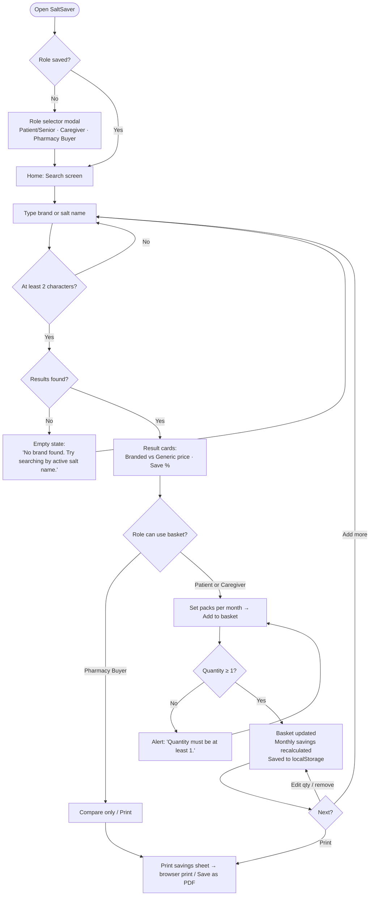
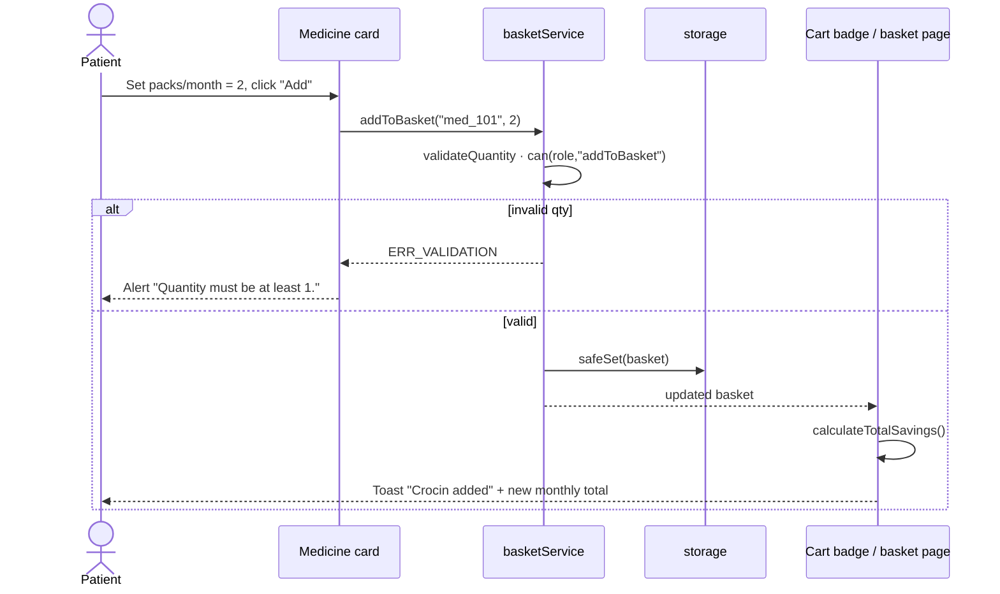

# SaltSaver — User Workflow

> Companion to [ARCHITECTURE.md](ARCHITECTURE.md). This document describes **what the user sees and does**, step by step. Each step names the PRD requirement it covers and the module that handles it.
> Diagrams use Mermaid. They render on GitHub and in VS Code with the "Markdown Preview Mermaid Support" extension.

---

## 1. Who uses SaltSaver and why

| Persona | Typical situation | Main goal | Key screens |
|---|---|---|---|
| **Patient / Senior citizen** (e.g. a 68-year-old on BP and diabetes medicines) | Pays ₹2,000+ a month for 3–4 branded medicines | Find cheaper generics and know how much they'll save each month | Search → Card → Basket → Print |
| **Caregiver** (son, daughter, nurse) | Manages medicines for a parent | Build the parent's monthly list and print it to take to the pharmacy | Search → Basket → Print |
| **Pharmacy buyer** (rural chemist / Jan Aushadhi Kendra staff) | Customer asks "is there a cheaper one?" at the counter | Quick salt lookup and price comparison, **no basket** | Search → Card → (Print a single comparison) |

---

## 2. Master flow (all roles)



---

## 3. Screen map

The app has **two pages** that share one navbar, one store and one localStorage basket:
`index.html` (search) and `cart.html` (Prescription Basket). Everything else is a modal or a section on those pages.

```
index.html — search
┌────────────────────────────────────────────────────────────────────┐
│ NAVBAR SaltSaver | Role ▾ | A- A A+ | Contrast | Reset |  [🛒 Basket ②]│
├────────────────────────────────────────────────────────────────────┤
│  Search medicine by brand or salt  [ Crocin______________ ] [Search]│
│  Try: Crocin · Paracetamol · Metformin · Amlodipine                 │
├────────────────────────────────────────────────────────────────────┤
│ RESULTS (aria-live: "2 medicines")                                  │
│ ┌───────────────────────────────┐ ┌───────────────────────────────┐ │
│ │ Crocin 500mg · Salt chip       │ │ Calpol 500mg · Salt chip       │ │
│ │ Branded ₹30.00 │ Generic ₹5.50 │ │ ...                            │ │
│ │ [Save 81%] Packs [-]1[+] [Add] │ │                                │ │
│ └───────────────────────────────┘ └───────────────────────────────┘ │
└────────────────────────────────────────────────────────────────────┘

cart.html — Prescription Basket (full page, opened from the 🛒 icon)
┌────────────────────────────────────────────────────────────────────┐
│ NAVBAR (same)                                    [🛒 Basket ②] active│
│ ← Continue searching                                               │
│ My Prescription Basket                                             │
├──────────────────────────────────────┬─────────────────────────────┤
│ Crocin 500mg            [Remove]     │ MONTHLY SUMMARY (2)         │
│ Ask for: Jan Aushadhi Paracetamol    │ Branded total     ₹ 85.00   │
│ Packs/month [-] 2 [+]                │ Generic total     ₹ 17.00   │
│ Branded ₹60 · Generic ₹11 · Save ₹49 │ YOU SAVE / MONTH  ₹ 68.00   │
│ Glycomet 500 ...                     │ [Print] [Continue searching]│
│ ⓘ WHO-approved salts disclaimer      │ [Clear basket]              │
└──────────────────────────────────────┴─────────────────────────────┘
  Mobile: the 🛒 icon stays visible next to the menu button; the summary stacks below the list.
```

| Screen / component | Module | When it shows |
|---|---|---|
| Role selector modal | `ui/roleSelector.js` | First visit, or when "Role ▾" is clicked |
| Search bar + example chips | `ui/searchView.js` | Always |
| Result cards | `ui/medicineCard.js` | After a search that finds results |
| Empty / error states | `ui/searchView.js`, `ui/alerts.js` | No match, data load failed |
| Cart icon + badge | `ui/cartBadge.js` | Both pages; hidden for Pharmacy Buyer |
| Prescription Basket page | `cart.html` + `ui/basketView.js` | Opened from the cart icon; Patient / Caregiver only |
| Print sheet | `ui/printView.js` + `print.css` | Only while printing |
| Storage banner | `ui/alerts.js` | localStorage is full or unavailable |

---

## 4. Detailed workflows

### W1 — First visit and role selection
*PRD §4 "Select Active Role" · `roleSelector.js`, `roles.js`, `storage.js`*

| # | User does | System does |
|---|---|---|
| 1 | Opens the site | Loads `sample-data.json` into localStorage and builds the salt index. Search is disabled while loading and a spinner reads "Loading medicines…". |
| 2 | — | No `saltsaver:v1:role` is saved, so it opens a modal: **"Who is using SaltSaver today?"** with 3 large buttons, each with an icon and a one-line description. |
| 3 | Taps **Patient / Senior** | Saves the role, closes the modal, moves focus to the search box. The navbar shows "Role: Patient". |
| 4 | Comes back on another visit | The role is remembered and the modal is skipped. The basket and font size are also restored. |

**Edge case:** if the user closes the modal without choosing, the role defaults to **Patient** (the most capable role, so nothing is hidden), and a small hint says "You can change role anytime from the top bar."

---

### W2 — Search a medicine and see generic substitutes
*FR-01, FR-02, BR-02, BR-03 · `searchView.js`, `medicineService.js`, `search.js`, `medicineCard.js`*

| # | User does | System does |
|---|---|---|
| 1 | Types `cro` | Waits 250 ms after the last keystroke, then searches brand, salt **and** generic names. |
| 2 | — | Shows "Crocin 500mg" first (brand prefix match ranks highest). Screen readers hear "1 medicine found". |
| 3 | Reads the card | Brand, manufacturer, **salt badge "Paracetamol 500mg"**, Branded **₹30.00** vs Jan Aushadhi Generic **₹5.50**, green **"Save 81%"**, and the WHO disclaimer. |
| 4 | Taps the salt badge | Runs a new search for that salt, which lists **every brand with the same salt** (Crocin, Calpol, Dolo…) so the user can compare them all. |
| 5 | Searches `paracetamol` instead | Gets the same family of results, ranked by salt-prefix match (BR-03). |

**States the search area can be in:**

| State | Trigger | What the user sees |
|---|---|---|
| Idle | Nothing typed | Example chips: "Try: Crocin · Metformin · Amlodipine" |
| Too short | 1 character | Hint: "Type at least 2 letters" |
| Results | ≥ 1 match | Cards (max 20) + count |
| Not found | 0 matches | **"No brand found. Try searching by active salt name."** + example chips |
| No saving | generic ≥ brand price | Grey badge "No saving", Add button still allowed |
| Data error | JSON failed to load | Red alert "Could not load medicine data. Please refresh." Search disabled |

---

### W3 — Build the monthly prescription basket
*FR-03, FR-04, BR-01, PRD §12 · `basketService.js`, `savings.js`, `validate.js`, `basketView.js`*



| # | User does | System does |
|---|---|---|
| 1 | Sets **packs per month = 2** on the Crocin card and clicks **Add to basket** | Validates the quantity (1–999). Adds the line and saves it. Toast: "Crocin 500mg added to your basket." The basket count badge goes up. |
| 2 | Searches `metformin`, adds Glycomet × 1 | Second line added. The totals update **live**: Branded total, Generic total, **You save ₹X / month (Y%)** (FR-03). |
| 3 | Adds Crocin again × 1 | The quantity is **merged** (2 → 3). No duplicate line is created. |
| 4 | Changes the quantity with −/+ in the basket | Recalculates instantly. Pressing "−" at quantity 1 asks "Remove Crocin from basket?" instead of going to 0. |
| 5 | Types `0` in a quantity box | Blocked with the alert **"Quantity must be at least 1."** and the field resets to its previous value. |
| 6 | Clicks 🗑 on a line | Removes it. The toast offers **Undo** for 5 seconds. |
| 7 | **Reloads the page** | The basket is restored from localStorage with the same totals (FR-04 acceptance test). |

**Empty basket state:** "Your basket is empty. Search a medicine and tap *Add to basket* to see your monthly savings." The Print button is disabled (`ERR_EMPTY_BASKET`).

---

### W4 — Print / save the savings sheet for the pharmacy counter
*FR-05 · `printView.js`, `print.css`*

| # | User does | System does |
|---|---|---|
| 1 | Clicks **🖨 Print savings sheet** | Builds the print sheet and opens the browser print dialog. |
| 2 | Chooses a printer, or **Save as PDF** | Prints only the sheet below: no navbar, no buttons, black-on-white, 12pt type. |
| 3 | Takes the paper to a Jan Aushadhi Kendra | The pharmacist reads the **salt names and generic names**, not the brand names. |

```
 SaltSaver — Generic Medicine Savings Sheet          Date: 18 Nov 2026
 ─────────────────────────────────────────────────────────────────────
 Brand (prescribed) │ Active salt       │ Ask for (generic)        │Qty│ Save/mo
 Crocin 500mg       │ Paracetamol 500mg │ Jan Aushadhi Paracetamol │ 2 │ ₹49.00
 Glycomet 500       │ Metformin 500mg   │ Jan Aushadhi Metformin   │ 1 │ ₹27.00
 ─────────────────────────────────────────────────────────────────────
 Branded ₹96.00 · Generic ₹20.00 · YOU SAVE ₹76.00 per month (79%)
 Generics contain identical WHO-approved active chemical salts.
 Prices are indicative. Consult your doctor before switching medicines.
```
*(Illustrative numbers, not real prices.)*

**Pharmacy buyer variant:** there is no basket, so each card has a small **"Print this comparison"** link. It prints a one-row version of the same sheet.

---

### W5 — Accessibility controls (senior citizens)
*PRD §16 risk mitigation · `a11yControls.js`*

| # | User does | System does |
|---|---|---|
| 1 | Taps **A+** | The whole page scales from 100% → 125% → 150%. The layout reflows without horizontal scrolling. The choice is saved. |
| 2 | Taps **◐ Contrast** | Switches to the high-contrast theme (black / white / yellow). The choice is saved. |
| 3 | Uses only the keyboard | Tab order: Skip link → Search → Results → Basket. Enter adds an item, Esc closes a modal, and the focus ring is always visible. |
| 4 | Uses a screen reader | Hears the result count, toasts ("Crocin added. You now save ₹76 per month") and alerts. |

---

### W6 — Switch role
*`roleSelector.js`, `roles.js`*

| From → To | Effect |
|---|---|
| Patient → Pharmacy Buyer | The cart icon and "Add" buttons are **hidden** (cart.html shows a notice), but the basket data is **kept**, not deleted. "Print this comparison" appears on cards. |
| Pharmacy Buyer → Caregiver | The cart icon reappears and cart.html shows the previously saved items. |
| Any → Any | The search results stay on screen. Toast: "Role changed to Caregiver." |

---

### W7 — Reset demo data
*PRD §4 "Reset Medicine Database State" · `dataService.resetDemo()`*

| # | User does | System does |
|---|---|---|
| 1 | Clicks **⟲ Reset** in the navbar | Confirm modal: "Reset demo? This clears your basket, role and settings and reloads the sample medicines." [Cancel] [Reset] |
| 2 | Confirms | Clears all `saltsaver:v1:*` keys, re-seeds from `sample-data.json` and rebuilds the index. The role selector opens again, as on a first visit. |

---

### W8 — Storage full / private browsing
*PRD §12 · `storage.js`*

| # | Situation | System does |
|---|---|---|
| 1 | Saving to localStorage fails (quota exceeded or blocked) | Switches to in-memory storage silently. Everything still works. |
| 2 | — | Shows a yellow banner at the top: **"Storage is full — your basket will be kept until you close this tab. Print it to keep a copy."** It links to Print. |

---

## 5. Role × workflow matrix

| Workflow | Patient / Senior | Caregiver | Pharmacy Buyer |
|---|---|---|---|
| W1 Select role | ✅ | ✅ | ✅ |
| W2 Search & compare | ✅ | ✅ | ✅ |
| W3 Basket & monthly savings | ✅ | ✅ | ❌ hidden + blocked in service |
| W4 Print savings sheet | ✅ full basket | ✅ full basket | ✅ single comparison |
| W5 Accessibility controls | ✅ | ✅ | ✅ |
| W6 Switch role | ✅ | ✅ | ✅ |
| W7 Reset demo | ✅ | ✅ | ✅ |

---

## 6. Messages catalogue (single source for UI text)

Keep all of these in `js/config.js` as `MESSAGES`, so the wording is consistent and easy to translate later (e.g. Hindi).

| Key | Text | Shown in |
|---|---|---|
| `NOT_FOUND` | No brand found. Try searching by active salt name. | Search empty state |
| `QTY_MIN` | Quantity must be at least 1. | Alert (W3) |
| `QTY_MAX` | Quantity can be at most 999. | Alert (W3) |
| `DISCLAIMER` | Generics contain identical WHO-approved active chemical salts. | Every card + print sheet |
| `PRICE_NOTE` | Prices are indicative. Consult your doctor before switching medicines. | Print sheet, footer *(pending mentor review)* |
| `ADDED` | {brand} added to your basket. | Toast |
| `EMPTY_BASKET` | Your basket is empty. Search a medicine and tap *Add to basket*. | Basket page |
| `STORAGE_FULL` | Storage is full — your basket will be kept until you close this tab. | Banner |
| `DATA_LOAD_FAIL` | Could not load medicine data. Please refresh. | Alert |
| `RESET_CONFIRM` | Reset demo? This clears your basket, role and settings. | Modal |

---

## 7. Demo script (5 minutes, for the final presentation)

1. Open the site. The role modal appears. Pick **Patient / Senior**.
2. Tap **A+** twice and turn on contrast, to show the senior-friendly design. Then turn them back off.
3. Search **"Crocin"**. The card shows **₹30.00 vs ₹5.50, Save 81%** (FR-01, FR-02).
4. Tap the **Paracetamol** salt badge to show all brands with the same salt.
5. Add Crocin × 2. Search **"Metformin"** and add 1. Point out the **combined monthly savings** (FR-03).
6. Try quantity **0** to show the validation alert (§12).
7. **Reload** the page. The basket is still there (FR-04).
8. Click **Print**. Show the clean sheet and "Save as PDF" (FR-05).
9. Switch to **Pharmacy Buyer**. The basket hides and the comparison still works (§4 matrix).
10. Search **"xyz"** to show the not-found message. Then **Reset demo**.

Each step above maps to a row in `docs/TEST_LOG.md`.
