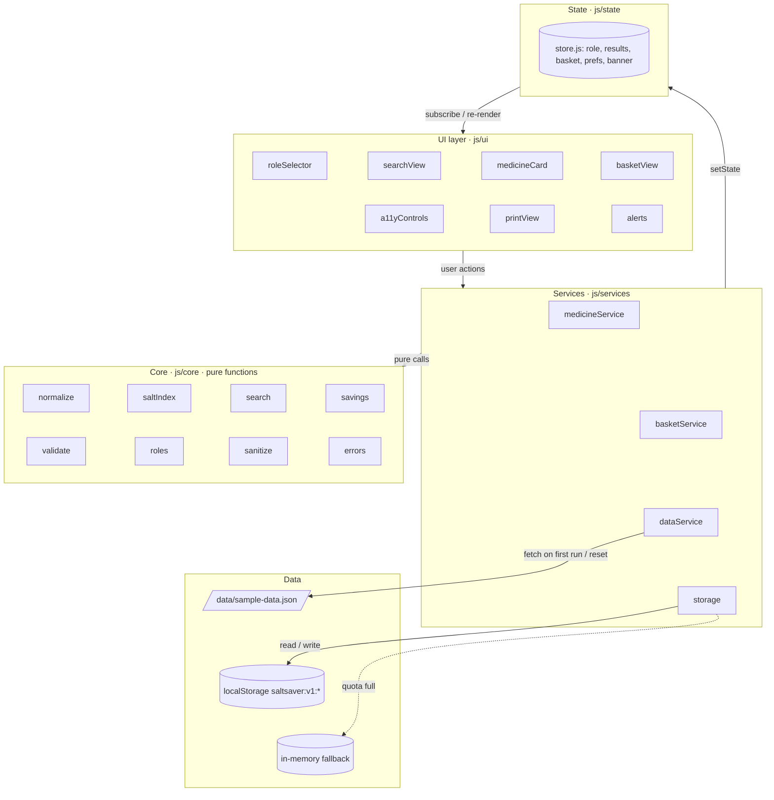
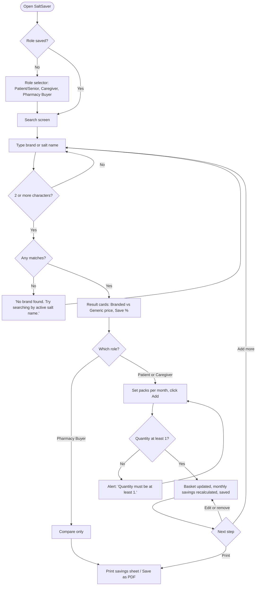
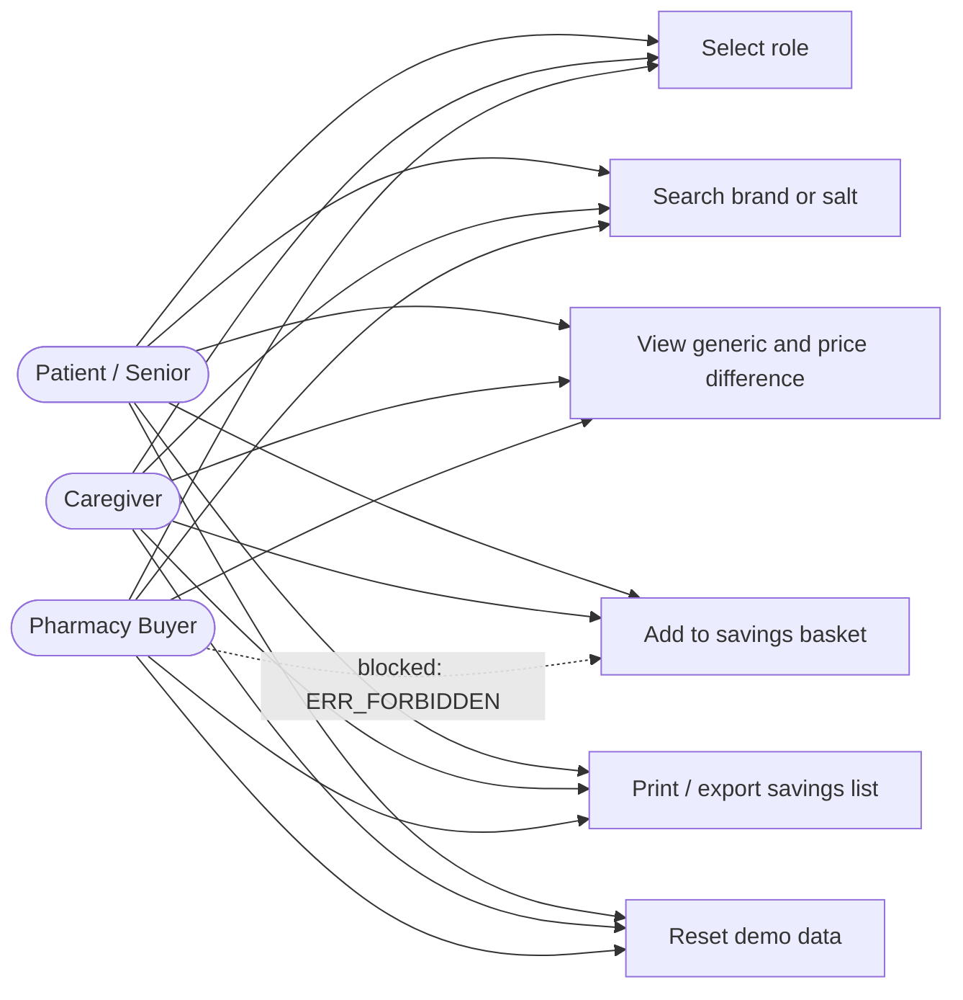
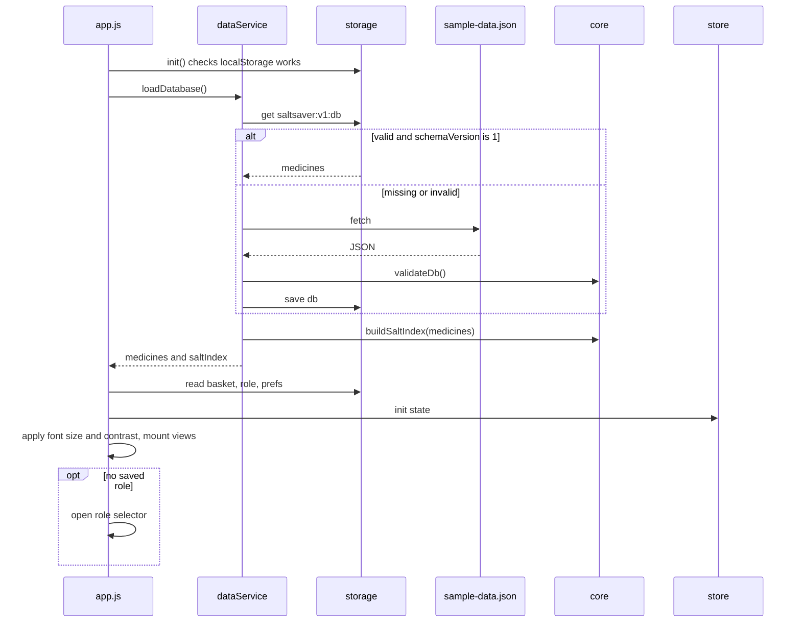
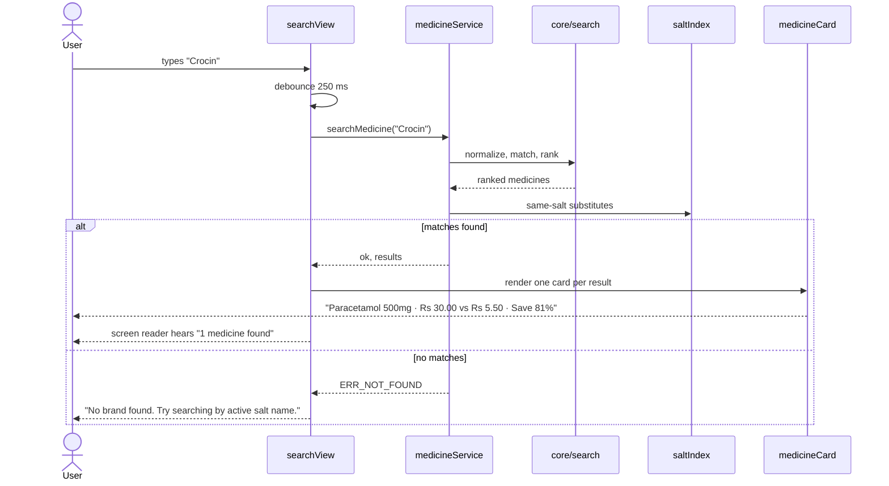
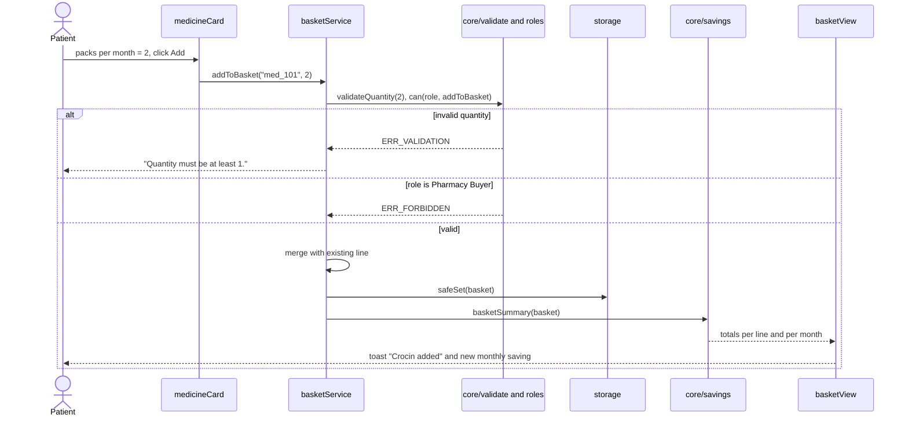
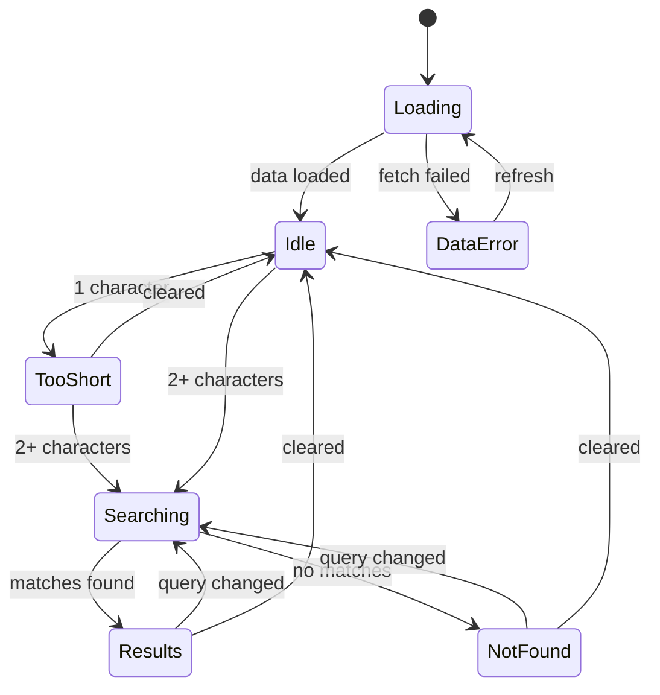
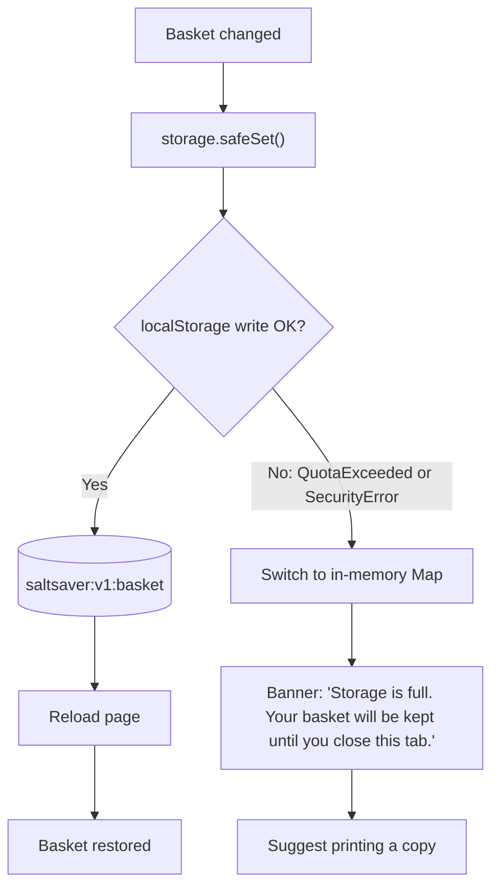
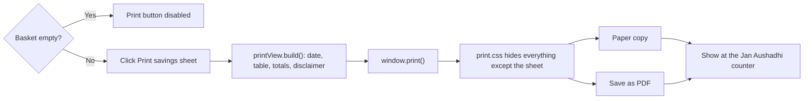
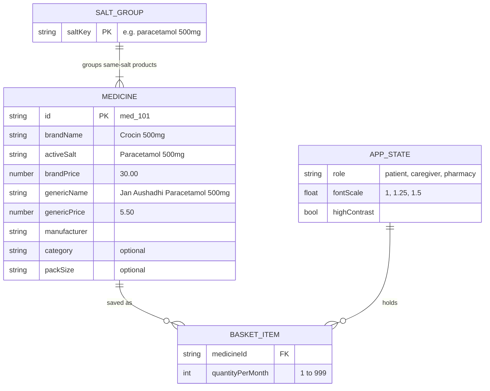

# SaltSaver — Diagrams

> **Note (Nov 2026):** these diagrams show the original static version. The current data flow is shown in [DATA_ARCHITECTURE.md](DATA_ARCHITECTURE.md#overview).

> Mermaid sources for every diagram. They render on GitHub; in VS Code install "Markdown Preview Mermaid Support". See [ARCHITECTURE.md](../ARCHITECTURE.md) and [USER_WORKFLOW.md](../USER_WORKFLOW.md).

## System architecture
*ARCHITECTURE §1–2* — Four layers in a static, browser-only app. Arrows point downward only: core never imports from services or UI, so it can be tested on its own and reused in a React refactor.

## User workflow
*USER_WORKFLOW §2* — The whole journey for all three roles, including the error branches from PRD §12.

## Roles and capabilities
*PRD §4* — The PRD capability matrix. The Pharmacy Buyer has no basket; this is checked in the UI and again in basketService.

## App start-up
*ARCHITECTURE §6.1* — localStorage is used when it holds a valid database; otherwise the app seeds it from sample-data.json.

## Search and substitute cards
*FR-01 · FR-02 · BR-03* — Search runs 250 ms after the last keystroke and matches brand, salt and generic names.

## Add to basket and savings
*FR-03 · FR-04 · BR-01* — savings = (brandPrice − genericPrice) × quantity, calculated in whole paise. The basket stores only IDs and quantities.

## Search area states
*USER_WORKFLOW W2* — Every state the results area can show, and what moves it between them.

## Storage and fallback
*PRD §12* — When localStorage is full or blocked, the basket moves to memory for the rest of the tab and a banner tells the user.

## Print savings sheet
*FR-05* — No PDF library: the print stylesheet shows only the sheet, and the browser's "Save as PDF" gives the PDF.

## Data model
*PRD §8 · ARCHITECTURE §3* — Medicines are grouped by a normalized salt key. Basket items point to a medicine by ID; prices are always read from the medicine record.

